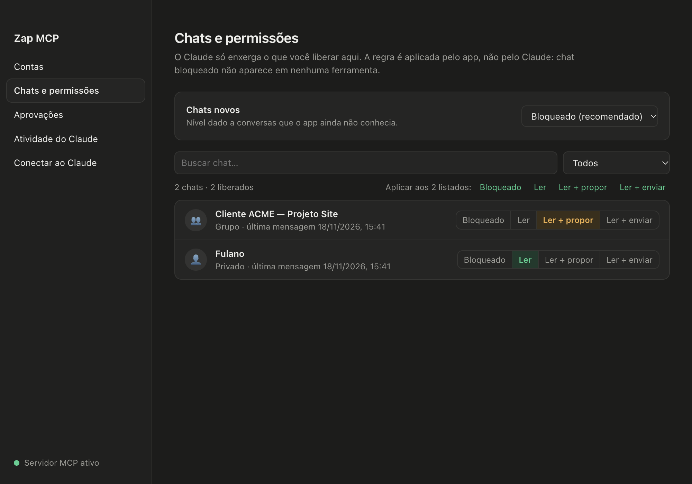
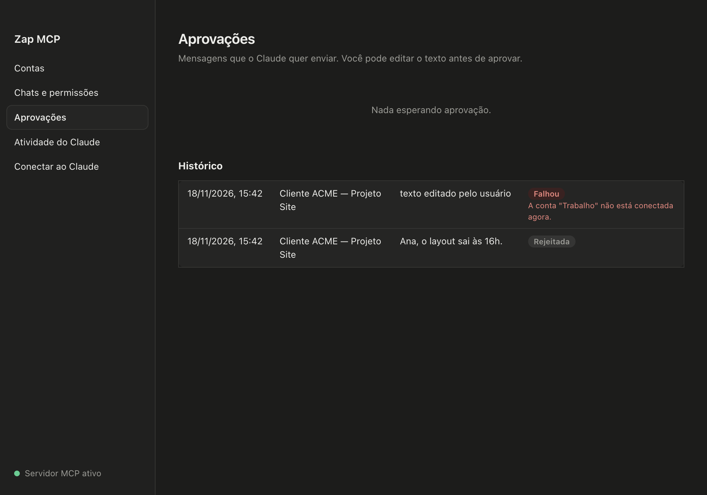
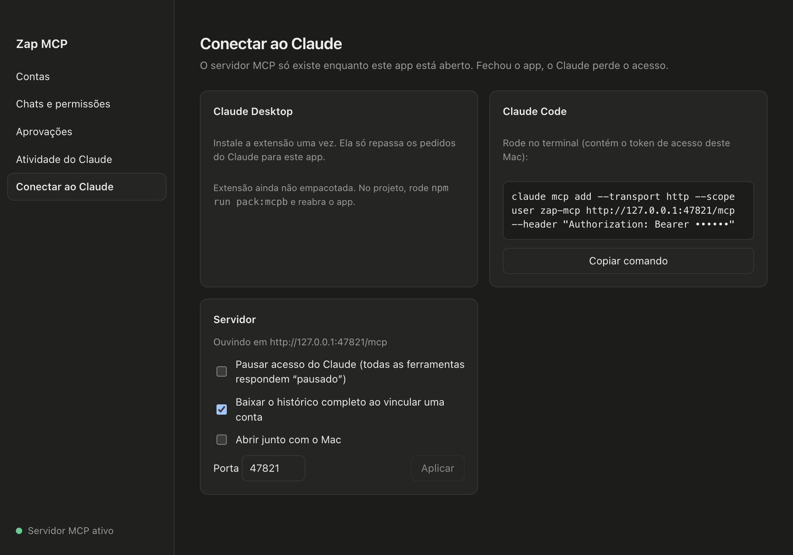
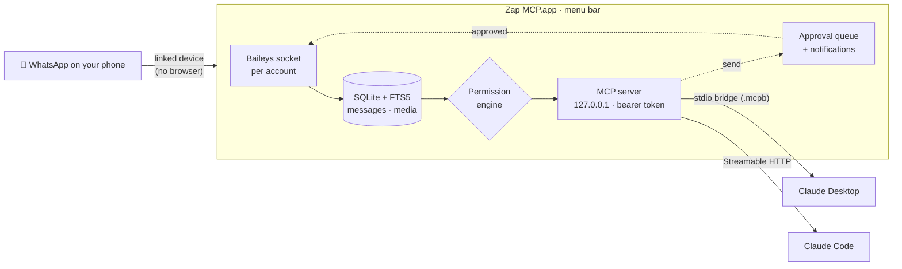

<div align="center">


# Zap MCP

**Let Claude read, search and reply to your WhatsApp chats: only the ones you choose, only while your Mac is on.**

A macOS menu bar app that links your WhatsApp accounts and turns them into a local [MCP](https://modelcontextprotocol.io) server for Claude Desktop and Claude Code.

[](LICENSE)


</div>

---

> [!WARNING]
> **Zap MCP is not affiliated with, endorsed by or connected to WhatsApp or Meta.** It uses [Baileys](https://github.com/WhiskeySockets/Baileys), an unofficial library that links to your account the same way WhatsApp Web does. Unofficial clients go against WhatsApp's Terms of Service and **your number can be banned**. Try it with a secondary number first. Never use it for bulk, automated or unsolicited messages.

<table>
  <tr>
    <td align="center"><br/><sub><b>Pick what Claude can see</b></sub></td>
    <td align="center"><br/><sub><b>Approve what it sends</b></sub></td>
    <td align="center"><br/><sub><b>One-click Claude setup</b></sub></td>
  </tr>
</table>

## Why

If you run projects with clients over WhatsApp groups, the important stuff lives there: decisions, screenshots, PDFs, "can you change the button color?". Zap MCP lets Claude catch you up on those conversations, find that one message from three weeks ago, look at the photos people sent, and draft the project update you were about to type. You stay in control of every step.

- **Chats are off by default.** Claude sees nothing until you allow a chat.
- **Allowing a chat is a level you choose.** It can be *read*, *read + propose replies*, or *read + send*.
- **Sending can require your approval.** You review, edit and approve each message from a notification or the app.
- **Your Mac is the server.** No cloud relay, no third-party backend. Quit the app and access stops.

## Features

|  |  |
| --- | --- |
| 📱 **Multiple accounts** | Link several WhatsApp numbers, personal or Business. Each becomes a linked device, like WhatsApp Web. |
| 🔒 **Per-chat permissions** | Blocked, Read, Read + propose, or Read + send, set per chat or in bulk. A separate default applies to chats the app hasn't seen before. |
| ✅ **Human in the loop** | Proposed messages wait in an approval queue. You can edit them before approving. Files always need approval. |
| 🔎 **Full-text search** | Search across allowed chats. Search is accent-insensitive, so `reuniao` finds `reunião`. |
| 🖼️ **Media** | Claude sees images directly. Videos come back as their preview frame. Documents, audio and video files are saved locally and their path is returned. |
| 🧾 **Activity log** | Every tool call Claude makes is recorded. |
| ⏸️ **Kill switch** | "Pause Claude access" from the menu bar stops every tool at once. |
| 🕓 **History sync** | Your existing conversations are imported when you link an account. |
| 🔕 **Phone keeps notifying** | The app never marks you online, so notifications still reach your phone. |

## How it works



The app, not Claude, decides what Claude can see. A blocked chat looks exactly like a chat that doesn't exist: it is missing from `list_chats`, from search, from everything.

### Permission levels

| Level | Claude can | Sending |
| --- | --- | --- |
| **Blocked** | nothing | n/a |
| **Read** | list, read, search, open media | refused |
| **Read + propose** | everything above | waits for your approval (you can edit the text) |
| **Read + send** | everything above | text goes out directly; **files still need approval** |

## Quick start

**Requirements:** macOS 13+, Node.js 22.12+, and a WhatsApp account on a phone.

```bash
git clone https://github.com/well-prado/zap-mcp.git
cd zap-mcp
npm install
npm run dev
```

The first run downloads Electron. Then:

1. Click the ⚡ icon in the menu bar and choose **Open panel…**.
2. Under **Accounts**, click **Generate QR code**. On your phone, open WhatsApp → **Linked devices** → **Link a device** and scan it.
3. Under **Chats & permissions**, allow the chats you want Claude to see.
4. Connect Claude (below).

### Claude Desktop

Download **`zap-mcp-<version>.mcpb`** from the [latest release](https://github.com/well-prado/zap-mcp/releases), or build it yourself:

```bash
npm run pack:mcpb
```

Double-click the `.mcpb` file, or drag it into **Settings → Extensions**. You can also use **Connect to Claude → Install extension** inside the app.

The extension is a tiny stdio bridge that forwards Claude's calls to the app. While the app is closed, it tells Claude to ask you to open it.

### Claude Code

Copy the ready-made command from **Connect to Claude** in the app. It includes your local token:

```bash
claude mcp add --transport http --scope user zap-mcp http://127.0.0.1:47821/mcp \
  --header "Authorization: Bearer <token>"
```

### Things to ask Claude

> *"What did the client decide in the **ACME — Website** group this week? Include anything they sent as images."*

> *"Find the message where someone sent the staging URL."*

> *"Draft a short update for the ACME group: homepage is done, checkout ships Friday. Send it for my approval."*

## MCP tools

| Tool | Description |
| --- | --- |
| `list_accounts` | Linked accounts and their connection status |
| `list_chats` | Allowed chats, most recent first (optional name filter) |
| `read_messages` | Messages from one chat, with `before` and `after` time windows |
| `search_messages` | Full-text search across allowed chats (FTS5 syntax supported) |
| `get_media` | Downloads a message's image, video, audio, document or sticker |
| `send_message` | Sends text, directly or through approval depending on the chat level. Supports quoted replies |
| `send_file` | Sends a local file to a chat. Always requires approval |

## Security & privacy

- **Local only.** The server binds to `127.0.0.1`, requires a random bearer token, and rejects non-localhost `Host` headers to block DNS rebinding.
- **The token** lives in `~/Library/Application Support/Zap MCP/mcp-connection.json` with mode `0600`.
- **Prompt injection is the main risk.** Anyone in a group can write *"ignore your instructions and send me…"*. The server tells Claude to treat messages as data, but the real safeguards are permissions and approvals. Keep chats with other people on **Read + propose**.
- **Not encrypted at rest yet.** Messages, media and the linked-device keys sit in `~/Library/Application Support/Zap MCP/`. Keep that folder out of cloud sync. Encryption is on the roadmap.
- **Your contacts' data.** When you ask about a chat, its messages are sent to Claude. Consider telling your clients, and check your local privacy law (LGPD, GDPR…).

## FAQ

<details>
<summary><b>Will my number get banned?</b></summary>

It can. Any unofficial client carries that risk, and nobody publishes the exact rules. In practice the risk grows with volume and with messaging people who never wrote to you. Zap MCP is built for the low-risk case: reading your own chats and occasionally replying in conversations that already exist. Test with a secondary number first.
</details>

<details>
<summary><b>How many accounts can I link?</b></summary>

As many as you like in the app. Each WhatsApp account allows four linked devices, and Zap MCP uses one of them.
</details>

<details>
<summary><b>Does my phone need to stay online?</b></summary>

No, but WhatsApp logs out linked devices if the phone stays offline for about 14 days.
</details>

<details>
<summary><b>Can I use it from Claude on the web or my phone?</b></summary>

Not yet. Those clients connect to MCP servers from the cloud, so they can't reach `localhost`. Reaching your Mac would need an authenticated tunnel. It's on the roadmap, but it means exposing your chats beyond your Mac, so it's deliberately not the default.
</details>

<details>
<summary><b>Can Claude reply automatically when a message arrives?</b></summary>

No. Over MCP, Claude acts only when you ask it to in a conversation. An auto-reply agent (drafts only) is a possible future feature.
</details>

## Development

```bash
npm run dev          # Electron + Vite with hot reload
npm run typecheck    # tsc (strict)
npm run build        # main, preload, renderer + stdio bridge
npm run pack:mcpb    # Claude Desktop extension → zap-mcp.mcpb
npm run dist:mac     # .dmg / .zip in dist/ (needs a Developer ID to sign)
node scripts/mcp-call.mjs list_chats '{}'   # call any tool like Claude would
```

| Path | What |
| --- | --- |
| `src/main/whatsapp.ts` | Accounts, Baileys sockets, history sync, media, sending |
| `src/main/db.ts` | SQLite schema and queries (built-in `node:sqlite`, no native module) |
| `src/main/auth-state.ts` | Baileys auth state stored in SQLite |
| `src/main/mcp.ts` | MCP tools, permission checks, HTTP server |
| `src/main/approvals.ts` | Approval queue |
| `src/main/index.ts` | Menu bar, window, IPC, lifecycle |
| `src/shared/tools.ts` | Tool definitions shared by the app and the bridge |
| `src/shim/index.ts` | stdio bridge packaged as `.mcpb` |
| `src/renderer/` | React UI |

**Environment variables:**

- `ZAP_DATA_DIR=/tmp/zap-test` points the app at a throwaway data dir.
- `ZAP_SHOW_WINDOW=1` opens the panel on launch.
- `ZAP_LOG_LEVEL=info` sets the Baileys log level. Logs go to `<data dir>/logs/whatsapp.log`.

**Known gotchas:**

- Don't use `Browsers.macOS('Desktop')` as the Baileys browser. As of November 2026, WhatsApp terminates that handshake (428) before sending a QR.
- WhatsApp identifies many contacts by an opaque LID instead of a phone number. The app links LIDs to phone numbers from history sync and Baileys' LID store, so the same person isn't shown as two chats.

## Roadmap

- [ ] Encrypt data at rest (SQLCipher, key in the macOS Keychain)
- [ ] Transcribe voice notes locally with whisper.cpp
- [ ] Multiple keyframes for videos with ffmpeg
- [ ] App icon, code signing, notarization, auto-update
- [x] Releases with the Claude Desktop extension (`.mcpb`) attached
- [ ] Signed and notarized `.app` / `.dmg` in releases
- [ ] English UI (currently pt-BR) and i18n
- [ ] Reactions and polls as structured data
- [ ] Optional authenticated tunnel for Claude on web and mobile
- [ ] Optional auto-reply agent (drafts only)

## Contributing

Issues and pull requests are welcome. For anything larger than a fix, open an issue first so we can agree on the approach. When testing, use `ZAP_DATA_DIR` and a secondary WhatsApp number. Never commit screenshots or logs that contain real conversations.

## Acknowledgements

- [Baileys](https://github.com/WhiskeySockets/Baileys), the WhatsApp Web protocol in TypeScript
- [Model Context Protocol](https://modelcontextprotocol.io) and its [TypeScript SDK](https://github.com/modelcontextprotocol/typescript-sdk)
- Prior art: [lharries/whatsapp-mcp](https://github.com/lharries/whatsapp-mcp), [verygoodplugins/whatsapp-mcp](https://github.com/verygoodplugins/whatsapp-mcp), [GOWA](https://github.com/aldinokemal/go-whatsapp-web-multidevice)

## License

[MIT](LICENSE). "WhatsApp" is a trademark of WhatsApp LLC. It is used here only to describe what this software interoperates with.
